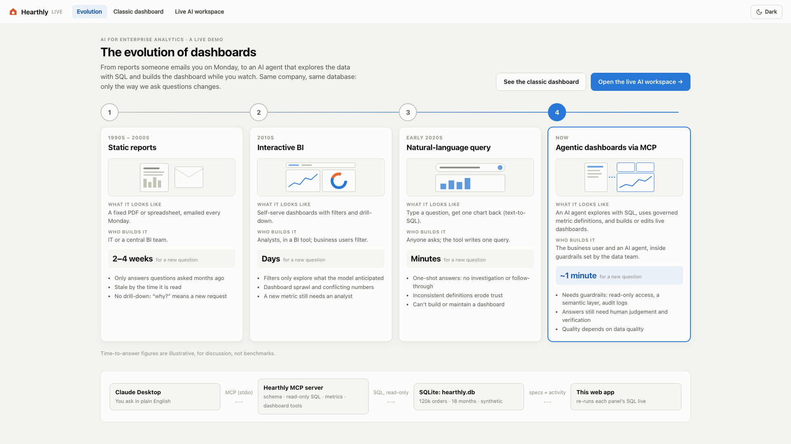
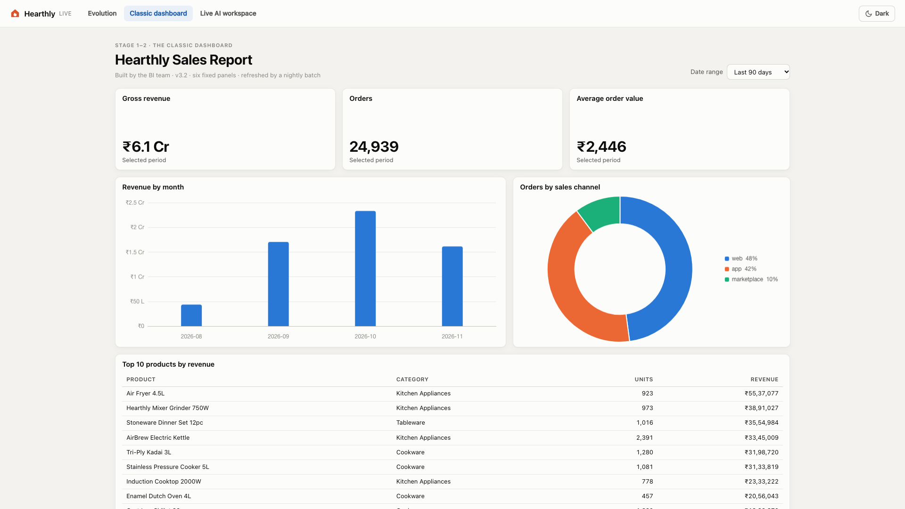
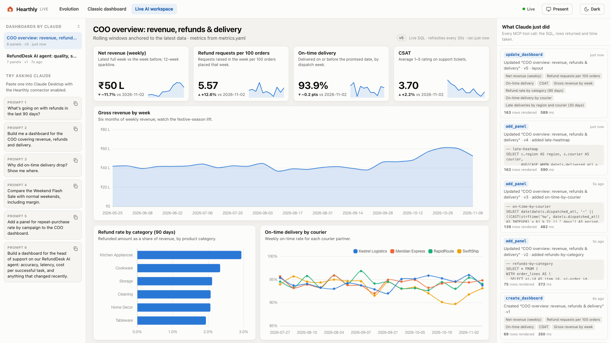

# Hearthly Live

**Static dashboards vs AI-built dynamic dashboards: a fully local teaching demo.**

Hearthly is a fictional direct-to-consumer home & kitchen brand in India. This repo gives it a
deterministic SQLite database (18 months, ~120k orders, synthetic), a local web app with a
deliberately limited *classic* dashboard, and a *live AI workspace* where Claude, connected
over MCP, explores the data with SQL and builds or edits dashboards while the audience watches.

| `/` The evolution of dashboards | `/static` The classic dashboard | `/dynamic` The live AI workspace |
|---|---|---|
|  |  |  |

Everything runs on your machine: no cloud services, no API keys, nothing fetched at runtime
(Chart.js is vendored). Python 3.11+ with [uv](https://docs.astral.sh/uv/); dependencies are pinned.

---

## 5-minute quick start

```bash
cd hearthly-live
./run.sh setup        # uv sync (pinned deps) + Playwright's Chromium (only needed for screenshot tests)
./run.sh seed         # builds data/hearthly.db: 18 months ending yesterday, seed 42 (~3 s)
./run.sh web          # http://127.0.0.1:8000  (leave this running)
```

In a second terminal:

```bash
./run.sh config       # prints the Claude Desktop JSON and the `claude mcp add` command for THIS machine
```

Then connect Claude (below), open http://127.0.0.1:8000/dynamic and ask:

> Build me a dashboard for the COO covering revenue, refunds and delivery.

The tool calls stream into **What Claude just did** on the right; the dashboard appears in the
centre as soon as Claude creates it (about a minute and a half end-to-end in testing, most of it
Claude investigating before it builds).

No Claude connection in the room? `./run.sh demo` builds a COO dashboard panel by panel through
exactly the same tool code (`./run.sh demo --all` also builds the RefundDesk agent dashboard).

### All commands

| Command | What it does |
|---|---|
| `./run.sh setup` | Create `.venv` with pinned deps, install Chromium for Playwright |
| `./run.sh seed` | `python -m hearthly.seed --reset` → `data/hearthly.db` and `docs/DEMO_SECRETS.md` |
| `./run.sh web` | Web app on http://127.0.0.1:8000 |
| `./run.sh mcp` | MCP server over stdio (`python -m hearthly.mcp_server`); normally Claude starts this for you |
| `./run.sh mcp-http` | MCP server over streamable HTTP on http://127.0.0.1:8765/mcp |
| `./run.sh demo` | Fallback: build sample dashboards through the tool path |
| `./run.sh reset` | Delete all dashboards and the activity feed (do this before class) |
| `./run.sh test` | Full test-suite (add `-m "not browser"` to skip Playwright) |
| `./run.sh screenshots` | Regenerate `docs/screenshots/*.png` |
| `./run.sh config` | Print client configuration with absolute paths |
| `./run.sh` | setup if needed, seed if needed, then start the web app |

---

## Connect Claude Desktop

1. `./run.sh setup && ./run.sh seed` (the server refuses to start without the database).
2. `./run.sh config` (or `uv run python -m hearthly.print_config`) prints a snippet like this, with
   **absolute paths for your machine**:

   ```json
   {
     "mcpServers": {
       "hearthly": {
         "command": "/Users/you/projects/hearthly-live/.venv/bin/python",
         "args": ["-m", "hearthly.mcp_server"]
       }
     }
   }
   ```
3. Claude Desktop → **Settings → Developer → Edit Config** opens
   `~/Library/Application Support/Claude/claude_desktop_config.json`
   (Windows: `%APPDATA%\Claude\claude_desktop_config.json`). Merge the `hearthly` entry into
   `mcpServers` and save.
4. **Fully quit** Claude Desktop (⌘Q, not just close the window) and reopen it. The Hearthly tools
   appear under the connectors / tools menu in a new chat.

The snippet points at the project's virtualenv interpreter, so it does not depend on Claude
Desktop's `PATH`. `print_config` also prints an equivalent `uv --directory … run` variant.

## Connect Claude Code

```bash
claude mcp add --transport stdio hearthly -- /ABSOLUTE/PATH/hearthly-live/.venv/bin/python -m hearthly.mcp_server
claude mcp list                      # should show: hearthly … ✔ Connected
```

(`./run.sh config` prints this line with your real path. Add `--scope user` to make it available
in every project.) Over HTTP instead: start `./run.sh mcp-http`, then

```bash
claude mcp add --transport http hearthly http://127.0.0.1:8765/mcp
```

---

## What's inside

```
hearthly/
  seed/            deterministic generator (seed 42), schema, presenter notes writer
  sqlguard.py      read-only SQL execution: mode=ro, query_only, authorizer, 5 s limit, row cap
  metrics.py       semantic layer: compiles metrics.yaml into SQL
  anomalies.py     recent window vs 6 baseline windows, z-score ranking
  spec.py          Pydantic dashboard spec + auto-layout
  validate.py      runs every panel's SQL and checks encodings → actionable errors
  state.py         data/state.db (WAL): dashboards, version history, activity log
  tools.py         tool implementations shared by MCP, the demo script and tests
  mcp_server.py    MCP server: 11 tools, 3 resources, 2 prompts; stdio or --http
  print_config.py  client config with absolute paths
  web/             FastAPI app, vanilla JS renderer, CSS, vendored Chart.js
metrics.yaml       metric definitions (the single source of truth)
scripts/           demo_dashboard.py (fallback), screenshots.py
tests/             pytest: seed, stories, SQL guard, metrics, specs, MCP, web, Playwright
docs/              DEMO_SECRETS.md (presenter only), screenshots/
```

### MCP surface

| Tools | |
|---|---|
| `describe_schema(table?)` | tables, columns, types, FKs, notes, allowed values, row counts, sample rows |
| `run_query(sql, limit=1000)` | one read-only SELECT → columns, rows, row_count, truncated |
| `list_metrics()` / `get_metric(name, grain, start?, end?, group_by?, rolling_days?)` | metrics.yaml, returns rows **and the SQL** |
| `detect_anomalies(metric, dimension, period)` | ranks groups by z-score vs six baseline windows |
| `create_dashboard(spec, replace?)` / `update_dashboard(id, patch)` / `add_panel` / `remove_panel` | validated, versioned, live |
| `list_dashboards()` / `get_dashboard(id)` | |

Resources: `hearthly://schema`, `hearthly://metrics`, `hearthly://dashboard_design_guide`.
Prompts: `weekly_ops_review`, `investigate_metric`.

### Dashboard spec

```json
{ "id": "coo-weekly", "title": "…", "subtitle": "…", "refresh_seconds": 30,
  "layout": [{"panel_id": "net-revenue", "x": 0, "y": 0, "w": 3, "h": 2}],
  "panels": [{"id": "net-revenue", "type": "kpi", "title": "Net revenue", "sql": "SELECT …",
              "encoding": {"x": "period", "value": "net_revenue", "format": "currency"},
              "insight": "One sentence on what to notice."}] }
```

Panel types: `kpi` (value, change vs previous row, sparkline), `line`, `area`, `bar`,
`stacked_bar`, `horizontal_bar`, `donut`, `table`, `scatter`, `heatmap`. Panels store SQL, never
data: every render (and every `refresh_seconds`) re-runs the SQL read-only. Layout is optional;
missing entries are packed into free grid space.

### Safety model

- Business DB opened with `file:…?mode=ro` and `PRAGMA query_only=ON`.
- A lexical check strips comments and strings and allows exactly one `SELECT`/`WITH` statement.
- A SQLite authorizer allows only reads, `SELECT`, recursive CTEs and an allowlist of pure
  functions: `ATTACH`, `PRAGMA` (including `pragma_*` table functions), writes, DDL and
  `load_extension` are refused by SQLite itself.
- A progress handler stops any query after 5 s; results are capped (1,000 rows for `run_query`,
  5,000 per panel).
- Every value from the database is treated as untrusted: the UI inserts it as text, never HTML
  (tested with injected `<script>`/`onerror` values), and tool descriptions tell Claude to treat
  values as data, not instructions.
- Every tool call is logged to `activity_log` (tool, args summary, SQL, rows, ms, status).
- The MCP server and web app bind to `127.0.0.1` only.

---

## Troubleshooting

| Symptom | Fix |
|---|---|
| Hearthly tools don't appear in Claude Desktop | Paths in the config must be absolute; run `./run.sh config` again and paste exactly. Fully quit Claude Desktop (⌘Q) and reopen. Check `~/Library/Logs/Claude/mcp.log` and `mcp-server-hearthly.log` (`tail -n 50 -f ~/Library/Logs/Claude/mcp*.log`). |
| `Business database missing` in the server log | Run `./run.sh seed`. |
| `spawn … ENOENT` | The `command` path is wrong (moved the folder? re-run `./run.sh setup` and `./run.sh config`). |
| Claude Code shows `✘ Failed to connect` | `claude mcp get hearthly` for details; run the command it shows by hand: it should sit silently waiting on stdin (Ctrl-C to exit). Slow first start? `MCP_TIMEOUT=20000 claude`. |
| `/dynamic` shows "Live (polling)" | The SSE stream dropped (proxy, sleep). It keeps working by polling every 2.5 s and reconnects on its own. |
| Dashboards from yesterday's rehearsal are still there | `./run.sh reset` |
| Dates look a day old | By design: data ends **yesterday**. Re-run `./run.sh seed` on the day of the class so "last 30 days" matches the calendar. |
| Port 8000 in use | `uv run uvicorn hearthly.web.app:app --host 127.0.0.1 --port 8010` (tool replies will still say 8000 unless you also set `HEARTHLY_WEB_PORT=8010` for the MCP server). |
| Playwright tests skipped | `uv run playwright install chromium` |

---

## Assumptions and decisions

- **MCP SDK v2.** The brief said FastMCP. The current official SDK (`mcp==2.3.0`) renamed FastMCP to
  `MCPServer` (`from mcp.server import MCPServer`), with the same decorator API. We use v2 (agreed
  during planning). It still accepts the classic `initialize` handshake (protocol 2024-11-05 →
  2025-11-25), which is what Claude Desktop uses; a test spawns the stdio server both ways.
- **"Today" moves.** The data covers the 548 days ending yesterday. Same seed + same day ⇒ identical
  database (tested); `python -m hearthly.seed --reset --as-of 2026-11-22` pins the date for rehearsals.
  The planted stories are anchored relative to that date, and `docs/DEMO_SECRETS.md` is regenerated
  with the measured numbers on every seed.
- **Rolling, complete periods.** Without explicit dates, `get_metric` emits SQL with a rolling window
  anchored to `MAX(order_date)` and, for week/month grains, keeps only complete periods, so saved
  dashboards stay live and period-over-period KPIs never compare a partial week.
- **Refund metrics are cohorted by order date** (stated in metrics.yaml), so recent weeks read low
  while refunds are still arriving. `refunds.amount` is the amount actually refunded (0 if denied).
- **Extra metrics** beyond the brief: `gross_margin_pct`, `tickets`, `agent_avg_latency_ms`,
  `repeat_purchase_rate` (needed for the demo prompts).
- **Customer segment** is a lifetime order-count bucket: new = 1, returning = 2–5, vip = 6+.
- **"About 1% of orders with NULL state"** is implemented on `shipments.destination_state`
  (orders have no state column in the brief's schema).
- **Agent model names** are neutral fictional identifiers (`hx-pro-…`, `hx-lite-…`), not real products.
- **Couriers and people are fictional**; customer emails use `example.com`.
- **Follow mode:** when Claude creates or edits a dashboard, `/dynamic` switches to it automatically.
- **Present mode** (button or `P`) hides the left sidebar and enlarges type; `T` toggles the theme.
- **Time-to-answer** figures on `/` are labelled illustrative.

## Presenter files

- [DEMO_SCRIPT.md](DEMO_SCRIPT.md): the 10-minute walkthrough.
- `docs/DEMO_SECRETS.md`: what is planted in the data, with dates and numbers. **Presenter only.**
